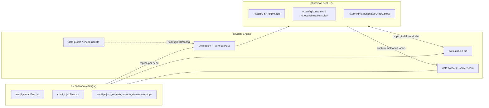

<div align="center">

# `~/dotfiles` — Terminal Environment & Explicit Sync Suite

[](#)
[](#)
[-cba6f7?style=flat-square)](#)
[](#)
[-f59e0b?style=flat-square)](#)

Configurações de terminal, temas, prompt e ferramentas modernas de linha de comando com **sincronização explícita** (`collect`, `apply`, `diff`, `doctor`) — sem symlinks frágeis espalhados no `$HOME` e com backup automático antes de qualquer escrita.

</div>

---

## Arquitetura de Sincronização (`dots`)

Em vez de acoplar o `$HOME` a links simbólicos que quebram quando ferramentas reescrevem arquivos de configuração, este repositório utiliza um manifesto declarativo (`configs/manifest.tsv`) e perfis de máquina (`configs/profiles.tsv`) operados pela CLI [`bin/dots`](bin/dots):



---

## Stack Incluída

| Camada | Componente | Caminho no Sistema | Caminho no Repo | Descrição |
| :--- | :--- | :--- | :--- | :--- |
| **Shell** | **Zsh + Zinit** | `~/.zshrc` | `configs/zsh/.zshrc` | Carregamento turbo (`wait lucid`), cache de `compinit` (24h), lazy-load de NVM e aliases de dev (`sbx`, `dots`, `ocd`). |
| **Prompt (Padrão)** | **Powerlevel10k** | `~/.p10k.zsh` | `configs/zsh/.p10k.zsh` | Estilo *Lean* de 2 linhas com `instant-prompt`, Git status, tempo de execução, RAM/CPU e versões de runtime. |
| **Prompt (Alt)** | **Starship / Spaceship** | `~/.config/starship.toml` | `configs/prompts/` | Tema customizado **Tactical** (`#1f2430` / `#82aaff`) + arquivo clássico preservado e config Spaceship. |
| **Terminal** | **KDE Konsole** | `~/.local/share/konsole/` | `configs/konsole/` | Perfil `zsh.profile` (`JetBrainsMono Nerd Font 13`, margem 6px, centro) + **18 paletas de cores** (`catppuccin-mocha`, `TokyoNight`, `Polar-Dusk`, etc.). |
| **Histórico & Nav** | **Atuin + Zoxide + FZF** | `~/.config/atuin/config.toml` | `configs/atuin/config.toml` | Histórico com busca fuzzy (`daemon-fuzzy`), `fzf-tab` completion e navegação inteligente via `zoxide`. |
| **CLI & Editor** | **Micro + btop + eza** | `~/.config/{micro,btop}` | `configs/{micro,btop}` | Editor de terminal padrão (`micro`), monitor de recursos (`btop` com tema Night Owl e fundo transparente) e `eza` com ícones/git. |

---

## Replicação Rápida em Outra Máquina (Bootstrap)

Em uma máquina nova (Ubuntu, Debian, WSL2, Arch ou Fedora):

```bash
git clone https://github.com/berndof/dotfiles.git ~/Workspace/dotfiles
cd ~/Workspace/dotfiles
./install.sh --all
```

O instalador detecta automaticamente o perfil sugerido para a máquina (`desktop`, `wsl`, `server` ou `minimal`), salva em `~/.config/dots/config` e ajusta pacotes, fontes e arquivos aplicados. Para forçar um perfil específico no bootstrap:

```bash
./install.sh --profile server    # Servidor SSH / headless (sem Konsole nem fontes)
./install.sh --profile wsl       # WSL2 (CLI + Git Delta; fontes ficam no Windows)
./install.sh --profile minimal   # Zero-sudo: apenas cli + apply (zsh, p10k, prompts, micro)
```

Você também pode executar etapas isoladas do instalador:

```bash
./install.sh --packages   # Instala pacotes base (omite fontconfig/emoji fora do perfil desktop)
./install.sh --cli        # Instala Zinit, Zoxide, Atuin, Starship e uv em ~/.local
./install.sh --fonts      # Baixa e instala a JetBrainsMono Nerd Font em ~/.local/share/fonts
./install.sh --apply      # Linka 'dots' em ~/.local/bin/dots e aplica os configs do perfil no ~/
./install.sh --shell      # Define /bin/zsh como login shell padrão do usuário (chsh)
```

---

## Uso Diário e Tracking de Melhorias (`dots`)

O binário `dots` fica disponível globalmente em `~/.local/bin/dots` (e via aliases `dstatus`, `ddiff`, `dcollect`, `dapply`, `dupdate`, `dprofile`, `dcheck`, `dtheme`, `ddoctor`, `dbench` no Zsh):

### 1. Verificar estado de sincronização e diffs
```bash
dots status               # Mostra tabela filtrada pelo perfil ativo + status do remote
dots status all           # Mostra todos os componentes do manifesto ignorando o perfil
dots diff                 # Exibe diff colorido entre o repositório e os arquivos ativos no ~/
dots diff zsh             # Exibe diff apenas do componente zsh
```

### 2. Perfis de Máquina (`dots profile`)
O estado local do perfil fica fora do Git em `~/.config/dots/config`, evitando conflitos entre workstation GUI, WSL2 e servidores SSH:

| Perfil | Componentes | Etapas Bootstrap | Fontes no Host |
| :--- | :--- | :--- | :--- |
| **`desktop`** | `zsh,p10k,git,konsole,prompts,atuin,micro,btop,fastfetch` | `packages,cli,fonts,apply` | Sim |
| **`wsl`** | `zsh,p10k,git,prompts,atuin,micro,btop,fastfetch` | `packages,cli,apply` | Não |
| **`server`** | `zsh,p10k,git,prompts,atuin,micro,btop,fastfetch` | `packages,cli,apply` | Não |
| **`minimal`** | `zsh,p10k,prompts,micro` | `cli,apply` | Não |

```bash
dots profile                    # Abre seletor interativo FZF (ou menu numerado sem FZF)
dots profile list               # Lista perfis, ativo atual e sugestão auto-detectada
dots profile set server --apply # Define perfil 'server' e aplica imediatamente
dots profile auto --apply       # Detecta automaticamente (wsl/server/desktop) e aplica
dots --profile desktop status   # Sobrescreve o perfil apenas para este comando
```

### 3. Update Checker e Sincronização Remota (`check-update` / `update`)
Ao abrir um terminal Zsh interativo, um hook leve (`precmd`, 0ms no boot) lê o cache em `~/.cache/dots/update-check.env`: se houver commits novos em `origin`, exibe um aviso discreto de 1 linha sugerindo `dupdate`; se o cache tiver mais de **12h**, dispara `dots check-update --quiet` em background sem bloquear o shell nem interferir no Powerlevel10k Instant Prompt.

```bash
dots check-update               # Faz fetch imediato e mostra commits pendentes
dots update --check             # Atalho equivalente para checar atualizações
dots update                     # Puxa commits (pull --ff-only) e aplica configs do perfil
dots check-update --interval 24 # Altera intervalo do check em background para 24h
dots check-update --disable     # Desativa o check automático em background
dots check-update --enable      # Reativa o check automático em background
```

### 4. Capturar melhorias feitas na máquina para o Git (`collect`)
Sempre que você editar `~/.zshrc`, ajustar o Konsole ou mudar configurações locais:
```bash
dots collect                                      # Copia do ~/ para configs/ + roda scanner anti-secrets
dots collect -c "feat(zsh): new aliases" -p       # Coleta, faz commit e git push em um único comando
```

### 5. Aplicar atualizações do repositório na máquina (`apply`)
Após dar `git pull` em outra máquina (ou restaurar configurações):
```bash
dots apply                # Aplica todos os arquivos do perfil ativo (com backup automático)
dots apply all            # Aplica todos os componentes do manifesto, incluindo Konsole
dots apply konsole        # Aplica apenas o perfil e os temas do Konsole
dots apply --dry-run      # Simula o que seria atualizado sem tocar no disco
```

### 6. Trocar Tema do Konsole ou Motor de Prompt (`theme`)
```bash
dots theme list                      # Lista todos os 18 esquemas de cores e prompts disponíveis
dots theme konsole TokyoNight        # Muda o esquema de cores para TokyoNight imediatamente
dots theme konsole catppuccin-mocha  # Volta para o Catppuccin Mocha
dots theme prompt starship           # Alterna o prompt do Zsh para o Starship (Tactical)
dots theme prompt p10k               # Alterna o prompt do Zsh para o Powerlevel10k
```

### 7. Diagnóstico, Benchmark de Boot e Backups
```bash
dots doctor               # Verifica binários, versões, fontes (conforme perfil), Zinit e secrets
dots bench 5              # Mede o tempo real de inicialização interativa do Zsh (ms) em 5 execuções
dots backup list          # Lista snapshots automáticos salvos em ~/.local/share/dotfiles-backups/
dots backup restore <id>  # Restaura um snapshot anterior
```

---

## Prompt em Terminal Remoto (SSH)

Três coisas determinam a aparência do prompt via SSH. As três precisam estar
certas **no lado certo**:

| Camada | Onde vive | Quem controla |
| :--- | :--- | :--- |
| **Engine** (p10k / starship) | servidor (`~/.zshrc`) | servidor |
| **Cores do prompt** | servidor (`~/.p10k.zsh`) | servidor |
| **Fonte + fundo do terminal** | **cliente** (Konsole) | cliente |

### Por que o prompt "fica fora do estilo" em acesso remoto

1. **O engine exibido não é o que o `dots status` reporta.**
   `dots status` faz *grep* no `~/.zshrc` em disco. Se o arquivo foi trocado
   depois do shell iniciar (ex.: um `dots apply` durante a sessão), a tela
   continua mostrando o engine antigo. Use `dots doctor` → **Prompt Live**,
   que consulta um shell de verdade.

2. **O plugin do Powerlevel10k precisa estar instalado.**
   Sem ele, o Zinit baixa o plugin *durante* a inicialização do shell,
   imprime `Downloading ...` no console e o p10k aborta com o bloco
   `Console output during zsh initialization detected`.
   O `install.sh` já pré-instala os plugins do Zinit; `dots doctor` avisa
   quando falta.

3. **Cores do prompt são truecolor, não índices 256.**
   O p10k usava índices xterm-256 (todos ≥ 28) — faixa que o Konsole *não*
   remapeia, ou seja, nenhuma cor era Solarized de verdade. Agora o p10k
   emite `38;2;R;G;B` (truecolor) com a paleta Solarized, lida do próprio
   `Solarized.colorscheme`. A cor fica idêntica em qualquer terminal.

4. **Fonte e fundo são do cliente.** O `konsolerc` e os `*.colorscheme` do
   servidor não têm efeito via SSH — quem desenha é o Konsole da sua
   máquina. Use o profile `zsh` (Solarized + JetBrainsMono Nerd Font).

### Manter as cores em Solarized

`tools/p10k-solarize.py` converte o `.p10k.zsh` para truecolor Solarized
de forma determinística e idempotente:

```bash
python3 tools/p10k-solarize.py --check configs/zsh/.p10k.zsh   # só verifica
python3 tools/p10k-solarize.py --diff  configs/zsh/.p10k.zsh   # mostra o diff
python3 tools/p10k-solarize.py         configs/zsh/.p10k.zsh   # converte
```

O mapeamento é **semântico** (papel do segmento → acento Solarized: git
clean→green, modified→yellow, dir→blue, error→red…), não uma troca
mecânica de índice. A paleta vem do `Solarized.colorscheme`; o script falha
alto se algum role ficar sem mapeamento.

---

## Estrutura do Repositório

```text
.
├── bin/
│   └── dots                         # CLI principal (status, diff, collect, apply, profile, check-update, update, theme, doctor, bench, backup)
├── configs/
│   ├── manifest.tsv                 # Manifesto declarativo: <componente> <caminho-repo> <caminho-home> <descrição>
│   ├── profiles.tsv                 # Definição dos perfis de máquina (desktop, wsl, server, minimal)
│   ├── zsh/                         # .zshrc e .p10k.zsh
│   ├── konsole/                     # konsolerc, zsh.profile, linux.keytab e 18 colorschemes/*.colorscheme
│   ├── prompts/                     # starship.toml (Tactical), starship-classic.toml e spaceship.zsh
│   ├── atuin/                       # config.toml
│   ├── micro/                       # settings.json e bindings.json
│   └── btop/                        # btop.conf
├── install.sh                       # Script idempotente de bootstrap multi-distro (Linux / WSL)
└── Makefile                         # Atalhos make (make status, make profile, make check-update, make apply, make doctor)
```
