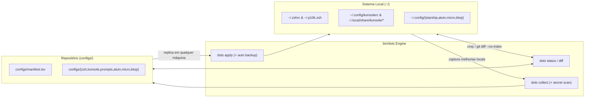

<div align="center">

# `~/dotfiles` — Terminal Environment & Explicit Sync Suite

[](#)
[](#)
[-cba6f7?style=flat-square)](#)
[](#)
[-f59e0b?style=flat-square)](#)

Configurações de terminal, temas, prompt e ferramentas modernas de linha de comando com **sincronização explícita** (`collect`, `apply`, `diff`, `doctor`) — sem symlinks frágeis espalhados no `$HOME` e com backup automático antes de qualquer escrita.

</div>

---

## Arquitetura de Sincronização (`dots`)

Em vez de acoplar o `$HOME` a links simbólicos que quebram quando ferramentas reescrevem arquivos de configuração, este repositório utiliza um manifesto declarativo (`configs/manifest.tsv`) operado pela CLI [`bin/dots`](bin/dots):



---

## Stack Incluída

| Camada | Componente | Caminho no Sistema | Caminho no Repo | Descrição |
| :--- | :--- | :--- | :--- | :--- |
| **Shell** | **Zsh + Zinit** | `~/.zshrc` | `configs/zsh/.zshrc` | Carregamento turbo (`wait lucid`), cache de `compinit` (24h), lazy-load de NVM e aliases de dev (`sbx`, `dots`, `ocd`). |
| **Prompt (Padrão)** | **Powerlevel10k** | `~/.p10k.zsh` | `configs/zsh/.p10k.zsh` | Estilo *Lean* de 2 linhas com `instant-prompt`, Git status, tempo de execução, RAM/CPU e versões de runtime. |
| **Prompt (Alt)** | **Starship / Spaceship** | `~/.config/starship.toml` | `configs/prompts/` | Tema customizado **Tactical** (`#1f2430` / `#82aaff`) + arquivo clássico preservado e config Spaceship. |
| **Terminal** | **KDE Konsole** | `~/.local/share/konsole/` | `configs/konsole/` | Perfil `zsh.profile` (`JetBrainsMono Nerd Font 13`, margem 6px, centro) + **18 paletas de cores** (`catppuccin-mocha`, `TokyoNight`, `Polar-Dusk`, etc.). |
| **Histórico & Nav** | **Atuin + Zoxide + FZF** | `~/.config/atuin/config.toml` | `configs/atuin/config.toml` | Histórico com busca fuzzy (`daemon-fuzzy`), `fzf-tab` completion e navegação inteligente via `zoxide`. |
| **CLI & Editor** | **Micro + btop + eza** | `~/.config/{micro,btop}` | `configs/{micro,btop}` | Editor de terminal padrão (`micro`), monitor de recursos (`btop` com tema Night Owl e fundo transparente) e `eza` com ícones/git. |

---

## Replicação Rápida em Outra Máquina (Bootstrap)

Em uma máquina nova (Ubuntu, Debian, WSL2, Arch ou Fedora):

```bash
git clone https://github.com/berndof/dotfiles.git ~/Workspace/dotfiles
cd ~/Workspace/dotfiles
./install.sh --all
```

Você também pode executar etapas isoladas do instalador:

```bash
./install.sh --packages   # Instala pacotes base (zsh, git, fzf, direnv, micro, btop, eza)
./install.sh --cli        # Instala Zinit, Zoxide, Atuin e Starship em ~/.local
./install.sh --fonts      # Baixa e instala a JetBrainsMono Nerd Font em ~/.local/share/fonts
./install.sh --apply      # Linka 'dots' em ~/.local/bin/dots e aplica os configs no ~/
./install.sh --shell      # Define /bin/zsh como login shell padrão do usuário (chsh)
```

---

## Uso Diário e Tracking de Melhorias (`dots`)

O binário `dots` fica disponível globalmente em `~/.local/bin/dots` (e via aliases `dstatus`, `ddiff`, `dcollect`, `dapply`, `dtheme`, `ddoctor`, `dbench` no Zsh):

### 1. Verificar estado de sincronização e diffs
```bash
dots status               # Mostra tabela de sincronia (IN SYNC vs DRIFT local/repo)
dots diff                 # Exibe diff colorido entre o repositório e os arquivos ativos no ~/
dots diff zsh             # Exibe diff apenas do componente zsh
```

### 2. Capturar melhorias feitas na máquina para o Git (`collect`)
Sempre que você editar `~/.zshrc`, ajustar o Konsole ou mudar configurações locais:
```bash
dots collect                                      # Copia do ~/ para configs/ + roda scanner anti-secrets
dots collect -c "feat(zsh): new aliases" -p       # Coleta, faz commit e git push em um único comando
```

### 3. Aplicar atualizações do repositório na máquina (`apply`)
Após dar `git pull` em outra máquina (ou restaurar configurações):
```bash
dots apply                # Aplica todos os arquivos (cria backup automático antes de sobrescrever)
dots apply konsole        # Aplica apenas o perfil e os temas do Konsole
dots apply --dry-run      # Simula o que seria atualizado sem tocar no disco
```

### 4. Trocar Tema do Konsole ou Motor de Prompt (`theme`)
```bash
dots theme list                      # Lista todos os 18 esquemas de cores e prompts disponíveis
dots theme konsole TokyoNight        # Muda o esquema de cores para TokyoNight imediatamente
dots theme konsole catppuccin-mocha  # Volta para o Catppuccin Mocha
dots theme prompt starship           # Alterna o prompt do Zsh para o Starship (Tactical)
dots theme prompt p10k               # Alterna o prompt do Zsh para o Powerlevel10k
```

### 5. Diagnóstico, Benchmark de Boot e Backups
```bash
dots doctor               # Verifica binários, versões, fontes Nerd/Emoji, Zinit e higiene de secrets
dots bench 5              # Mede o tempo real de inicialização interativa do Zsh (ms) em 5 execuções
dots backup list          # Lista snapshots automáticos salvos em ~/.local/share/dotfiles-backups/
dots backup restore <id>  # Restaura um snapshot anterior
```

---

## Estrutura do Repositório

```text
.
├── bin/
│   └── dots                         # CLI principal de gerenciamento (status, diff, collect, apply, theme, doctor, bench, backup)
├── configs/
│   ├── manifest.tsv                 # Manifesto declarativo: <componente> <caminho-repo> <caminho-home> <descrição>
│   ├── zsh/                         # .zshrc e .p10k.zsh
│   ├── konsole/                     # konsolerc, zsh.profile, linux.keytab e 18 colorschemes/*.colorscheme
│   ├── prompts/                     # starship.toml (Tactical), starship-classic.toml e spaceship.zsh
│   ├── atuin/                       # config.toml
│   ├── micro/                       # settings.json e bindings.json
│   └── btop/                        # btop.conf
├── install.sh                       # Script idempotente de bootstrap multi-distro (Linux / WSL)
└── Makefile                         # Atalhos make (make status, make diff, make collect, make apply, make doctor)
```
